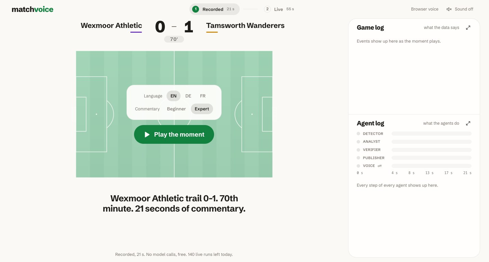
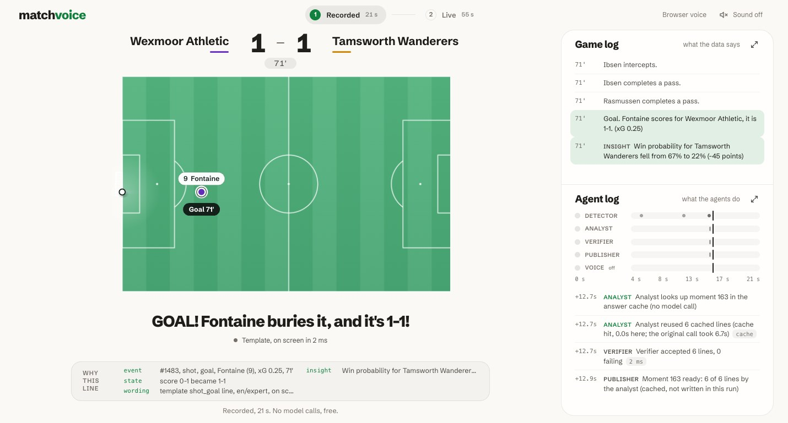
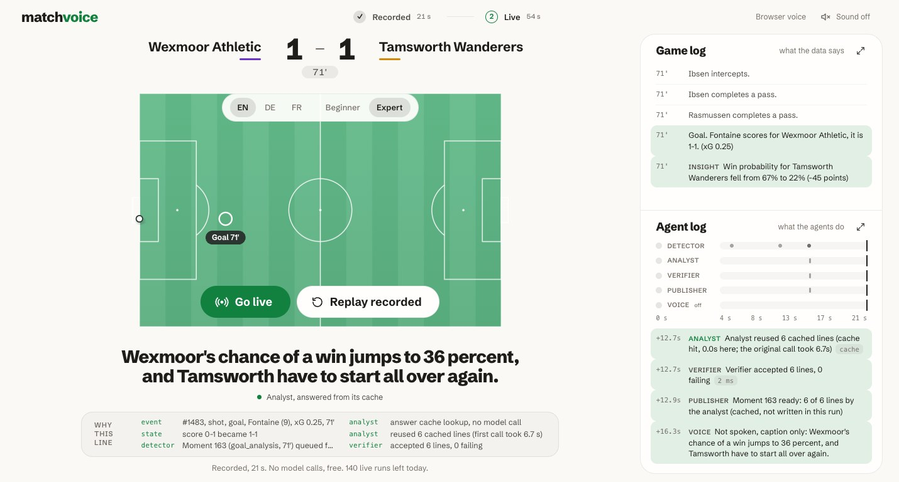

# match-voice

Every fan gets their own commentator. match-voice turns a stream of match events into live commentary in English,
German or French, for a beginner or an expert, and checks the model-written analysis against the facts before it is spoken.

Built for the Microsoft x Premier League "Inside the Game: Developer Hackathon". All teams, players and matches are
fictional and generated by this project. No real marks, data or music.

One screen, two steps, no scrolling. Step 1 plays a recorded moment (21 seconds around an equaliser at 71'); Step 2 goes
live: a new random match every time, 60 seconds at match pace, commentary written while it runs. Both are called in the fan's
language and style by the browser voice. Next to the pitch two logs show the work: a game log (what the data says) and an
agent log with one lane per agent (who works when). A "why this line" box under the caption shows the real data behind it,
and each log opens in full in a modal.

| Start | The goal, analyst line | End |
| --- | --- | --- |
|  |  |  |

## What it does

- **Six voices at once.** Three languages (en, de, fr) times two styles (beginner, expert). Switch any time; the
  commentary is written natively in each language, not translated.
- **Facts first.** Players, scorelines and numbers come from the fact engine. Template lines are filled only from
  fact-engine values, and the evaluation re-checks all 818 spoken lines (100% pass). A deterministic verifier checks
  every model-written line before release and rejects invented
  numbers, a wrong scoreline, players who are not part of the moment, the wrong language and lines that are too long.
- **Agents with a job.** An Analyst agent (Claude Haiku on the Microsoft Agent Framework) writes the analysis, the
  Verifier checks it, a rejected line goes back once with the reason, and a template line takes over if the retry fails.
- **Speech with manners.** A director per channel keeps silence when nothing matters, interrupts for goals and red cards,
  and picks a wording that fits the time left.
- **Real time, honestly labelled.** Step 2 is live: events arrive at match pace (the server also supports 5x, 10x, 30x and a
  chosen start minute, the UI uses 1x), template lines are on screen within milliseconds, the analyst agent writes while play
  continues, and every caption shows its source and its delay from the event. Live needs a key, a call budget and runs left
  today. Without them the UI says so in one line and Step 1, the **recorded** moment (analyst lines written earlier), still
  plays in full. The public static build is Step 1 only.
- **For AI clients too.** An MCP server with 7 tools answers questions about a match, its commentary and its facts.

## Architecture


The rules require Ingest, Interpret, Explain, Render and Personalize. Here is where each lives.

| Stage | Module | Notes |
| --- | --- | --- |
| Ingest | `backend/matchvoice/sim/` | Seeded generator, three story arcs, about 2,000 events per match, plus a `truth.json` to score against |
| Interpret | `facts/`, `commentary/moments.py` | Live possession, xG, momentum and win probability; 21 kinds of moments detected from events and facts |
| Explain | `commentary/templates.py`, `analyst.py`, `verifier.py`, `newsroom.py` | Templates for play-by-play (252 wordings), Analyst and Verifier workflow for analysis |
| Render | `commentary/director.py`, `pipeline/`, `server/` | Director, one runner for live and replay, overlay protocol v1, FastAPI (WebSocket, SSE, `replay.json`) |
| Personalize | `ui/`, `mcp_server/` | Language and style channels in a single-screen UI; MCP tools |

More detail, a Mermaid diagram and the agent design are in [docs/ARCHITECTURE.md](docs/ARCHITECTURE.md). The wire format
is in [docs/PROTOCOL.md](docs/PROTOCOL.md).

## Run it

Requires Python 3.11 or newer. Node 20 or newer is needed to build the UI on a fresh clone (`ui/dist` is not committed).

```bash
python3 -m venv .venv
source .venv/bin/activate            # Windows: .venv\Scripts\activate
pip install -e ".[dev]"
python -m pytest -q                  # 171 tests, no key needed
```

Replay needs no key. A built UI is served by the same process, so build it first on a fresh clone (see "Build the UI"; the Dockerfile does this for you):

```bash
python -m matchvoice.server --port 8000          # open http://localhost:8000
python -m matchvoice.pipeline play --match comeback-7 --speed 60 --channel de/expert   # commentary in the terminal
python -m matchvoice.mcp_server                  # MCP over stdio
python -m matchvoice.evaluation                  # rewrites docs/EVAL.md and data/eval/results.json
```

Build the UI, or the static version that needs no server:

```bash
cd ui && npm ci
npm run build                        # served by the Python server
npm run build:static                 # ui/dist-static, plays the recorded insert (ui/public/insert/replay.json), no server needed
```

Live mode is real time and is Step 2 of the UI (it asks `GET /api/guided-live` for a new random match and a window of about 54 seconds around a goal): the runner feeds events at match pace, the fast path (templates) speaks
at once, and the analyst newsroom runs while play continues. There is no lookahead and no recorded line is read. It needs a key in a git-ignored `.env` at the repository root
(`ANTHROPIC_API_KEY_2=...`) and an explicit call budget. Prompts that were already answered are served from
`data/cache/analyst` and cost nothing, but those lines are cached answers, not new model work: the UI marks them as cached ("answered from its cache") and leaves them out of the analyst latency. The three demo matches are fully cached. For truly fresh commentary start the server with `--live-fresh`, which never reads the cache and makes a real call for every analyst moment (about 8 calls per match).

```bash
python -m matchvoice.server --port 8000 --live-calls 12                 # cached answers are reused and marked
python -m matchvoice.server --port 8000 --live-calls 12 --live-fresh     # every analyst line is a real call
```

**Fresh matches and the demo insert.** The server simulates any `<arc>-<seed>` on request (`comeback-4242`, 0.02 s, nothing
written; the same seed is the same match and hits the caches). Step 2 of the UI uses this: `/api/guided-live` picks a random
arc and seed and the window of about 54 seconds around its best goal, and the UI streams that window over the WebSocket at 1x. Step 1
is the recorded demo insert, `comeback-135`, from 12 seconds before the home equaliser (71') to the end of its commentary
(`ui/public/insert/replay.json`, the same file with or without a server). You see play-by-play, the goal cutting off the line
that is talking, and the analyst's reaction. `GET /api/demo-insert` still describes it for tooling.

**Optional ElevenLabs voice.** With `ELEVENLABS_API_KEY` in `.env` the server speaks live lines through ElevenLabs
(`eleven_flash_v2_5`, voice Daniel). The key stays on the server: the browser can only ask for a line the server itself
published in a live run, and the server synthesises it when the voice actually starts it (skipped and stale lines cost
nothing). The guided UI does not use it: both steps are read by the browser voice. A hard credit budget (`--tts-credits`, default 300, counted from `data/cache/tts/ledger.jsonl`) and a disk cache
(`data/cache/tts`) keep the bill predictable. Without a key, over budget or on any error, the browser voice speaks and the
UI says which one is in use. The static build has no ElevenLabs voice.

```bash
python -m matchvoice.server --port 8000 --live-calls 3 --tts-credits 300   # --no-tts forces the browser voice
```

Other commands:

```bash
python -m matchvoice.sim --arc comeback --seed 7            # generate a match into data/matches
python -m matchvoice.facts data/matches/comeback-7          # key moments and win probability
python -m matchvoice.pipeline export --out ui/public/replays --speed 30
python -m matchvoice.pipeline export-insert                  # re-record the 30 s demo insert for the static build (answer cache only, no model call)
docker build -t match-voice . && docker run --rm -p 8000:8000 match-voice
```

The UI takes URL parameters for tooling: `lang`, `style`, `autoplay`, `mute`, `static` (play the recording even when a
server is there). Example: `http://localhost:8000/?lang=de&style=expert&autoplay=1`.

MCP setup for Claude Desktop is in [docs/MCP.md](docs/MCP.md), deployment options in [docs/DEPLOY.md](docs/DEPLOY.md).

## Evidence

From [docs/EVAL.md](docs/EVAL.md), which is generated by `python -m matchvoice.evaluation` with no model calls: 3 matches,
6 channels, 818 spoken lines at x30.

| Check | Result |
| --- | --- |
| Spoken lines the verifier accepts | 100.0% (0 failing of 818) |
| Injected errors the verifier catches | scoreline swapped 100.0% of 53, number changed 100.0% of 270, player swapped 99.8% of 589 |
| Key moments from `truth.json` found | 93.8% importance-weighted, 11 of 12 moments |
| Analyst lines that needed the template fallback in the recorded runs | 0 (23 model calls, 144 lines recorded) |
| Model calls used to build all three matches | 23 of a budget of 40 |

## Limitations

- Most spoken lines are templates. The analyst wrote 9.9% of the lines at x30 and 3.4% in real time, and 40% of the
  lines in the analyst's voice. The newsroom published every analyst line it was asked for; the loss happens when the
  director picks a shorter template wording to fit the time.
- Red cards get no analysis, and one of 12 truth moments is missed (a home momentum swing in `comeback-7`).
- The verifier checks facts, not judgement. "They dominate" passes if the numbers in it are right. It also missed one
  injected error, a German genitive ("Abaras Tor"), because it does not see a surname with a suffix.
- Analysis is captioned as soon as the model call and the verifier are done, about 6 seconds after the moment (median
  6.2 s of model latency recorded when the replays were made; with a fake model set to 5 s the line appears 5.06 s after the
  event, see CLAUDE.md Status). Play-by-play is captioned within milliseconds, the voice may be a few seconds behind or skip a
  line that would be stale.
- In real time the channels speak 16.6% of the match. At x30 every channel speaks all the time, because speaking
  time is multiplied by the speed. Speaking times are estimated from text length, not measured from audio.
- Three synthetic matches and one seed each. The truth file comes from the same simulator that produced the events.
- German and French wording has not been read by native speakers. The default voice comes from the browser, so quality
  depends on what the device ships with. The ElevenLabs voice is English only so far (German and French map to the same
  multilingual voice but were not tried) and is a live-run feature that needs a key and credits.
- xG is slightly high for point-blank shots.
- Live is real time only in the sense of the stream: the analyst needs about 6 seconds per call, so analysis lands
  seconds after its moment. Browser speech is cut when it would run past its slot, and lines older than 3 s (play-by-play)
  or 20 s (analysis) are captioned but not spoken.

## Layout

`CLAUDE.md` holds the module map, decisions and status. Docs: [ARCHITECTURE](docs/ARCHITECTURE.md),
[PROTOCOL](docs/PROTOCOL.md), [MCP](docs/MCP.md), [EVAL](docs/EVAL.md), [DEPLOY](docs/DEPLOY.md),
[PITCH](docs/PITCH.md), [VIDEO](docs/VIDEO.md).

## License

MIT. The names in this project are invented; any resemblance to real people or clubs is coincidental.
