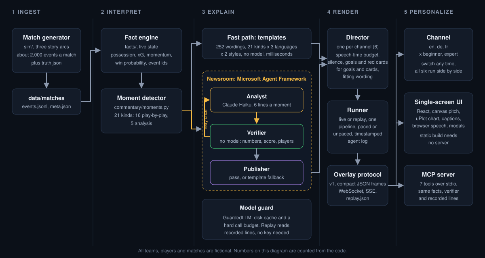
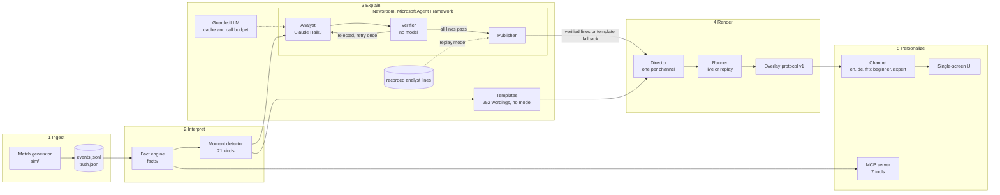

# Architecture

One pipeline, two ways to run it. `live` writes the analysis with a model while the match streams. `replay` runs the
same code and reads the analyst lines that a live run recorded, so it needs no key. The UI, the static build and the MCP
server all read the same overlay protocol or the same modules.

The SVG above is the same diagram drawn by hand for the submission page; the Mermaid source renders on GitHub.

## Stages and modules

| Stage | What happens | Modules |
| --- | --- | --- |
| 1 Ingest | A seeded generator plays a fictional match around a scripted story arc (`comeback`, `red_card`, `unlucky`). Each match has about 2,000 events (2,031, 2,132 and 2,162 for the three demo matches) and a `truth.json` that records what was scripted, so the output can be scored. | `sim/`, `data/matches/` |
| 2 Interpret | The fact engine folds events into live state (possession, shots, xG, momentum, win probability) and emits facts that carry the event ids they follow from. The moment detector turns events and facts into 21 kinds of moments, 16 of them play-by-play and 5 analysis. | `facts/`, `commentary/moments.py` |
| 3 Explain | Play-by-play uses a template bank (252 wordings, ordered short to long). Analysis goes through the newsroom: an Analyst agent writes six lines (3 languages x 2 styles), a deterministic Verifier checks each one, rejected lines go back once with the reason, and lines that still fail are replaced by template lines. | `commentary/templates.py`, `analyst.py`, `verifier.py`, `newsroom.py` |
| 4 Render | One director per channel schedules speech under a time budget: it keeps silence when nothing matters, lets the highest priority moment speak first, interrupts for goals and red cards, and picks the longest wording that fits. The runner drives it live or from a replay, and the protocol encoder writes compact frames. | `commentary/director.py`, `pipeline/runner.py`, `pipeline/protocol.py` |
| 5 Personalize | A channel is a language and a style. All six run side by side, and the viewer switches at any time. The UI draws captions, a canvas pitch and a win-probability chart, and speaks with the browser's own voices. The MCP server answers the same questions for an AI client. | `ui/`, `server/`, `mcp_server/` |

## The agents

The newsroom is a Microsoft Agent Framework workflow (`WorkflowBuilder`, three executors). The edges are conditional:
a draft with failing lines and a retry left goes back to the Analyst with the reasons; everything else goes to the
Publisher. `MAX_RETRIES` is 1.

| Agent | Uses a model | Job |
| --- | --- | --- |
| Analyst | yes, Claude Haiku through `agent-framework-anthropic` | Sees only the facts of one moment. Writes one line per channel, at most 150 characters, digits only for numbers that appear in the facts. |
| Verifier | no | Rejects invented numbers, a scoreline that is not the real one, players who are not part of the moment, the wrong language and lines that are too long. |
| Publisher | no | Releases lines that passed and swaps in a template line for any that did not, so commentary never goes out unchecked and never goes missing. |

Only four of the five analysis kinds (`momentum`, `goal_analysis`, `big_save_analysis`, `big_chance_analysis`) call
the model. Red cards, play-by-play and `shot_milestone` are template only.

`GuardedLLM` wraps every model call with a disk cache (`data/cache/analyst`) and a hard `CallBudget`. Building the
three demo matches took 23 Haiku calls and produced 144 recorded lines.

## Data flow of one goal

1. The generator emits a `shot` event with outcome `goal`.
2. The fact engine updates the score, xG and win probability and records the event id.
3. The detector creates a `shot_goal` moment (play-by-play) and a `goal_analysis` moment (analysis).
4. Every channel gets the template line at once. The analysis moment goes to the newsroom.
5. The Analyst writes six lines, the Verifier checks them, the Publisher releases them.
6. Each director decides whether the analysis fits before the next moment and which wording to use.
7. The runner emits `say` and `log` messages. The UI shows the caption, plays the voice and fills the agent log.

## Why the overlay format is cheap

Frames are arrays and numbers, not objects with named fields; the tables that decode them are sent once in `hello`.
A frame carries the state after its events, so a client that drops one loses only those events. For `comeback-7`
at x30, `replay.json` holds 1,374 frames, 347 `say` messages and 56 `log` messages in 281 KB (54 KB gzipped).
The UI writes the pitch, chart, clock and score from one animation-frame loop and re-renders React only on rare
topics (match loaded, moments found, transport, agent log). The full contract is in [PROTOCOL.md](PROTOCOL.md).

## Two prototypes, one pipeline

| | Live | Replay |
| --- | --- | --- |
| Analyst lines | written now, through `GuardedLLM` | read from `data/replays/<match>/analyst.json` |
| Needs | `ANTHROPIC_API_KEY` and a call budget (`--live-calls N`) | nothing |
| Refuses to start | without a key or with a budget of 0 | never |
| Used for | the agent log with real model calls | the public demo, the static build, the evaluation |

The static build (`npm run build:static`, 1.5 MB) bundles `replay.json` for all three matches and runs with no server.
Deploy options are in [DEPLOY.md](DEPLOY.md).

## Limits

See the README for the honest list. The short version: most spoken lines are templates, the verifier checks facts and
not judgement, German and French wording has not been read by native speakers, and live mode was not exercised in
the browser (the live call budget is 0 by default).
