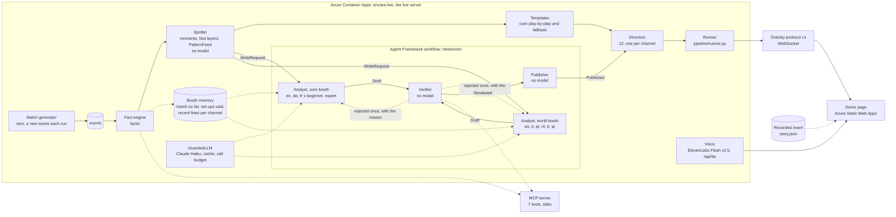

# Architecture

One pipeline, two ways to run it. `live` writes the commentary with a model while the match streams; the public live
server on Azure Container Apps runs it for "Generate run". `replay` runs the same code and reads the analyst lines that a
live run recorded, so it needs no key; the recorded demo insert is one. The page, the static build and the MCP server all
read the same overlay protocol or the same modules.

Five agents do the work: the spotter, the analyst, the verifier, the publisher and the directors. Only the analyst calls a
model, in two booths: the core booth (en, de, fr at two levels) and the world booth (es, it, pt, nl, tr, ja). Analyst,
verifier and publisher form one Microsoft Agent Framework workflow.

## Stages and modules

| Stage | What happens | Modules |
| --- | --- | --- |
| 1 Ingest | A seeded generator plays a fictional match around a scripted story arc (`comeback`, `red_card`, `unlucky`). Each match has about 2,000 events (2,031, 2,132 and 2,162 for the three demo matches) and a `truth.json` that records what was scripted, so the output can be scored. A generated live run simulates a new late scene of the same match on each click. | `sim/`, `data/matches/` |
| 2 Interpret | The fact engine folds events into live state (possession, shots, xG, momentum, win probability, the match so far) and emits facts that carry the event ids they follow from. The spotter turns events and facts into moments (21 analysis and play-by-play kinds plus the fast and context layers) and keeps state over the half to find a team's habit and the goal that breaks it. | `facts/`, `commentary/moments.py`, `fast.py`, `patterns.py` |
| 3 Explain | Core play-by-play uses a template bank. Analysis goes through the newsroom: an Analyst agent writes six core lines (3 languages x 2 levels) and, in a second call, six world-language lines; a deterministic Verifier checks each one, rejected lines go back once with the reason, and core lines that still fail are replaced by template lines (a world line that fails twice is not said). | `commentary/templates.py`, `analyst.py`, `world.py`, `verifier.py`, `newsroom.py` |
| 4 Render | One director per channel schedules speech under a time budget: it keeps silence when nothing matters, lets the highest priority moment speak first, interrupts for goals and red cards, and picks the longest wording that fits. The runner drives it live or from a replay, and the protocol encoder writes compact frames. | `commentary/director.py`, `pipeline/runner.py`, `pipeline/protocol.py` |
| 5 Personalize | A channel is a language and a level: 12 channels in 9 languages run side by side, and the viewer switches at any time. The page draws subtitles, a canvas pitch and the win probability. In a live run only the chosen channel is voiced, with ElevenLabs Flash v2.5; the browser voice is the fallback. The MCP server answers the same questions for an AI client. | `ui/`, `server/`, `tts/`, `mcp_server/` |

## The agents

The newsroom is a Microsoft Agent Framework workflow (`WorkflowBuilder`, three executors). The edges are conditional:
a draft with failing lines and a retry left goes back to the Analyst with the reasons; everything else goes to the
Publisher. `MAX_RETRIES` is 1. The core and the world booth run the same workflow, each with its own prompt.

| Agent | Uses a model | Job |
| --- | --- | --- |
| Spotter | no | Detects moments from events and facts, and follows the half to find a team's habit (set-up) and the goal that breaks it (pay-off). |
| Analyst | yes, Claude Haiku through `agent-framework-anthropic` | Sees the facts of one moment and the booth memory. Writes one line per channel, at most 150 characters, digits only for numbers that appear in the facts. Core booth: analysis and set-ups. World booth: every line, play-by-play included. |
| Verifier | no | Rejects invented numbers, a scoreline that is not the real one, players who are not part of the moment, a goal minute that does not match the match history, the wrong language and lines that are too long. |
| Publisher | no | Releases lines that passed and swaps in a template line for any core line that did not, so commentary never goes out unchecked. |
| Directors | no | One per channel: decide whether and when a line is spoken, and which wording fits the time left. |

The workflow passes four message types. A `WriteRequest` carries the moment, its facts, the recent lines per channel and,
on a retry, the reason each failing line was rejected. The Analyst answers with a `Draft` (one line per channel). The
Verifier emits a `Reviewed`, a frozen dataclass with the failing channels and the retry decision, so the edge conditions
never see state that changes later. The Publisher emits `Published`: the wordings per channel, short to long, their source
(analyst or template), the log trail and the latency.

In the core booth, four of the five analysis kinds (`momentum`, `goal_analysis`, `big_save_analysis`,
`big_chance_analysis`) and the spotter's set-ups call the model. Red cards, play-by-play and `shot_milestone` are
template only there.

`GuardedLLM` wraps every model call with a disk cache (`data/cache/analyst`) and a hard `CallBudget`; the live server
also has a daily cap. Building the three demo matches took 23 Haiku calls and produced 144 recorded lines.

## Data flow of one goal

1. The generator emits a `shot` event with outcome `goal`.
2. The fact engine updates the score, xG, win probability and the match so far, and records the event id.
3. The spotter creates a `shot_goal` moment (play-by-play) and a `goal_analysis` moment (analysis), and checks whether the goal breaks a habit it pointed out earlier.
4. Every core channel gets the template line at once. The analysis moment goes to the newsroom.
5. The Analyst writes six core lines and, in a second call, six world lines; the Verifier checks them, the Publisher releases them.
6. Each director decides whether the analysis fits before the next moment and which wording to use.
7. The runner emits `say` and `log` messages. The page shows the subtitle, plays the voice and fills the agent log.

## Why the overlay format is cheap

Frames are arrays and numbers, not objects with named fields; the tables that decode them are sent once in `hello`.
A frame carries the state after its events, so a client that drops one loses only those events. For `comeback-7`
at x30, `replay.json` holds 1,374 frames, 347 `say` messages and 56 `log` messages in 281 KB (54 KB gzipped).
The UI writes the pitch, chart, clock and score from one animation-frame loop and re-renders React only on rare
topics (match loaded, moments found, transport, agent log). The full contract is in [PROTOCOL.md](PROTOCOL.md).

## Live and recorded

| | Generated run (live) | Demo (recorded) |
| --- | --- | --- |
| Analyst lines | written now, through `GuardedLLM`, no cache read on the public server | read from the recorded insert |
| Needs | the live server with `ANTHROPIC_API_KEY` and its call budgets | nothing |
| Voice | ElevenLabs for the chosen channel, browser voice as fallback | baked ElevenLabs files |
| Runs on | Azure Container Apps (`encara-live`) | the static page on Azure Static Web Apps |

The static build (`npm run build:static`) bundles `ui/public/insert/story.json` and its baked audio and runs with no
server. Deploy details are in [DEPLOY.md](DEPLOY.md).

## Limits

See the README for the honest list. The short version: most core play-by-play lines are templates, the verifier checks
facts and not judgement, German, French and the world languages have not been read by native speakers, and the public
live server on Azure runs a generated scene with real model and voice calls under daily caps.
